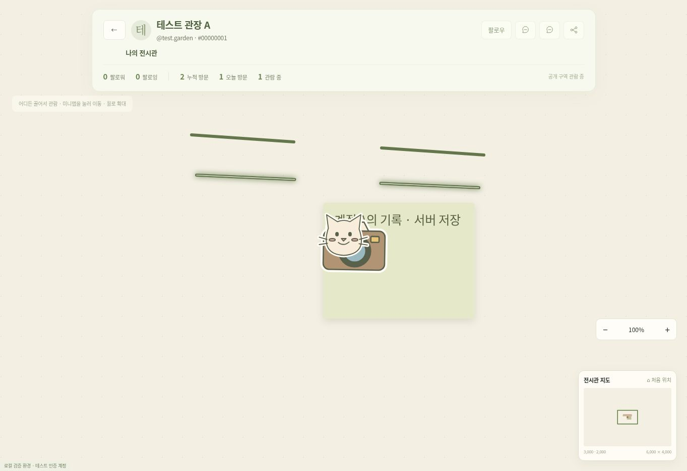
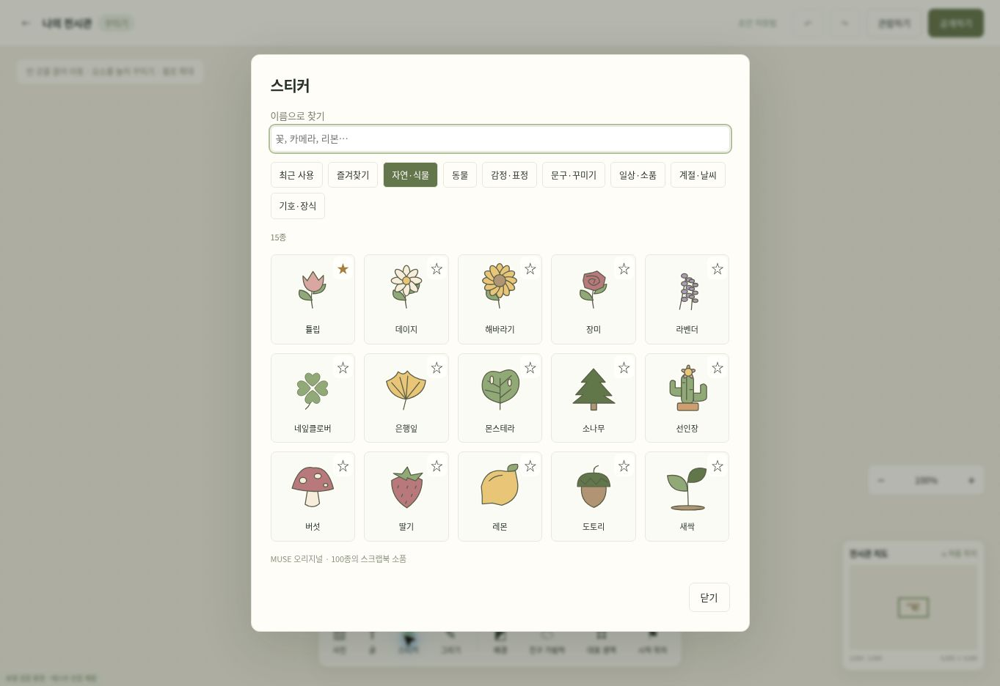
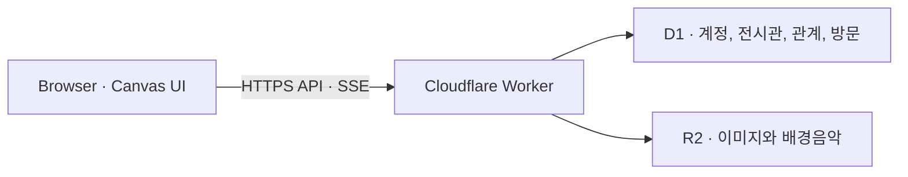

# MUSE

**A personal gallery for the things you love.**  
취향을 모아 나만의 전시관을 만들고, 다른 사람의 공간을 둘러보는 소셜 웹 서비스.

[Live Beta · 실제 서비스 열기](https://muse.wanderingcandy1.chatgpt.site) · [GitHub Profile](https://github.com/garden0323)

## Product Story

MUSE는 사진 한 장이나 짧은 글을 올리는 순간뿐 아니라, 여러 기록을 모아 두고 다시 둘러보는 경험에서 출발했습니다. 사용자는 캔버스 위에 기록을 배치하고, 서로의 전시관을 둘러보며 관심사를 발견합니다. 맞팔로우한 친구에게만 보여 주고 싶은 기록은 보드 안에서 구역을 지정해 공유할 수 있습니다.

## Key Features

| 기능 | 사용 경험 |
| --- | --- |
| **Gallery Board** | 넓은 2D 캔버스를 드래그·확대하고 미니맵으로 이동합니다. 사진, 메모, 드로잉, 스티커로 보드를 꾸미고 초안과 공개본을 관리합니다. |
| **Friend Mask** | 맞팔로우한 친구만 지정 구역의 기록을 볼 수 있습니다. 서버가 관계와 미디어 접근 권한을 확인합니다. |
| **Social & Messages** | 8자리 친구 코드로 사용자를 찾고, 팔로우하거나 메시지·방명록으로 교류합니다. |
| **Explore & Rankings** | 일일·누적 방문 랭킹과 뱃지로 전시관을 발견합니다. 공동 순위를 포함합니다. |
| **Gallery Audio** | 배경음악을 업로드하고 미리 듣거나 반복 재생을 설정합니다. 공개 후 방문자는 전시관에서 재생·음소거를 제어할 수 있습니다. |

## Screenshots

실제 MUSE UI를 로컬 테스트 계정으로 실행해 캡처한 개발 화면입니다.

**Gallery Board · 전시관 관람**



**Sticker Library · 보드 꾸미기**



## Stack & Architecture

| Layer | Technology |
| --- | --- |
| Frontend | JavaScript, HTML, CSS, Canvas 2D |
| Application | Cloudflare Workers, HTTP API, Server-Sent Events |
| Storage | Cloudflare D1 for records, R2 for uploaded media |
| Build & QA | esbuild, Node.js test runner, SQLite-backed local preview |
| Hosting | ChatGPT Sites |



## Repository Layout

| 경로 | 역할 |
| --- | --- |
| `dist/` | 브라우저에서 실행되는 UI, 캔버스 편집기, 기본 에셋 |
| `worker/` | 인증, 전시관, 메시지, 랭킹, 미디어 API |
| `drizzle/` | 데이터베이스 스키마와 마이그레이션 |
| `scripts/` | 로컬 미리보기 서버와 Worker 빌드 |
| `tests/` | 인증, 접근 제어, 보드, 채팅, 미디어 회귀 테스트 |
| `docs/screenshots/` | 테스트 계정으로 촬영한 실제 UI |

## Development Milestones

| 단계 | 주요 개선 |
| --- | --- |
| Prototype | 2D 보드, 미니맵, 전시물 편집과 전시관 프로필 구현 |
| Social Beta | 사용자 인증, 팔로우 관계, 친구 가림막, 메시지 연결 |
| v34 | 공동 순위를 포함한 누적·일일 방문 뱃지 구현 |
| v35–v36 | 다크 모드 메시지와 편집기 입력 요소의 가독성 개선 |
| v38 | 탐색에 랭킹 탭을 추가하고 전시관 배경음악 업로드를 연결 |

## Run Locally

Node.js **24** 및 npm이 필요합니다. 내려받은 프로젝트 디렉터리에서 실행합니다.

```bash
npm ci
npm run dev
```

[http://localhost:4173/__qa/a](http://localhost:4173/__qa/a)를 열면 테스트 계정으로 보드를 확인할 수 있습니다. 로컬 서버는 SQLite와 로컬 파일을 사용하며, 운영 계정이나 운영 저장소의 연결 정보가 필요하지 않습니다.

```bash
npm test
npm run build
```

공개용 소스는 v38을 기반으로 합니다. 운영 배포 매니페스트, 실계정에 관한 일회성 마이그레이션, 내부 검증 자료는 공개본에서 제외했고 관리자 식별자와 출처를 확인할 수 없는 사진은 예시로 교체했습니다.

## AI-assisted Development

**Garden · Product Planning, UI/UX, Development Direction**

서비스의 콘셉트와 사용자 흐름을 기획하고, 전시관의 편집·탐색 경험과 맞팔로우 공개 범위를 설계했습니다. 기능 우선순위와 화면 시안을 정하고, 구현 결과를 검토해 문제와 수정 방향을 구체화했습니다.

AI는 설계를 코드로 옮기고, 테스트를 작성하고, 오류 원인을 좁히고, 변경 사항을 배포하는 데 활용했습니다. 예를 들어 랭킹 화면을 만들 때는 기존 순위 계산과 공동 순위 규칙을 유지하도록 요구사항을 정의하고, 구현 결과는 목록·뱃지·카드 이동을 함께 검증했습니다.
